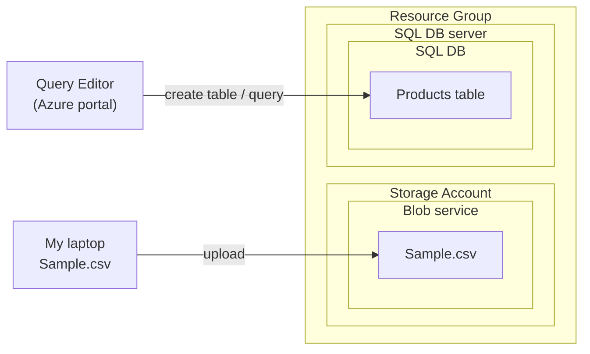

# Day 5 Notes - Azure Fundamentals

## Cloud basics

Cloud means using someone else's servers over the internet instead of running your own. You pay for what you use, can scale up or down quickly, and don't have to look after the hardware.

Three service types, depending on how much you manage yourself:
- **IaaS** - you get a virtual machine, you manage the OS and everything on it (Azure VM, AWS EC2)
- **PaaS** - the platform is managed, you just bring your data or code (Azure SQL Database, Blob Storage)
- **SaaS** - the full app is ready to use (Outlook, Gmail)

## How Azure is organised

- **Subscription** - the billing account, everything you create costs money against it
- **Resource group** - a folder for related resources. Every resource must be in one, and you can give access or delete the whole group at once
- **Region** - where the data centre physically is, like Central India. Keep resources that talk to each other in the same region

## AWS -> Azure

| AWS | Azure |
|---|---|
| S3 | Blob Storage |
| RDS | Azure SQL Database |
| Glue | Data Factory |
| IAM | Entra ID + role assignments |

## Blob Storage and Azure SQL

Blob Storage is like S3: **storage account -> container -> blob**. The storage account is the top level, containers are like folders, and blobs are the actual files.

Azure SQL Database is a managed SQL Server. You create a **SQL server** (the logical server with login and firewall) and then a **database** inside it. Azure handles backups, patching and updates.

## What I did

- created a resource group
- created a storage account and uploaded `Sample.csv` into Blob Storage
- created a SQL server and a SQL database, made a `Products` table and queried it from the Query Editor in the portal

## Diagram

Where my files and tables live:

Both live in the same resource group, but right now the file and the table are not connected. The CSV just sits in Blob Storage and the table was filled from the Query Editor. Moving data from Blob into SQL automatically is what Data Factory does (Day 8).

## Reflection

Azure follows a mandatory wrapper layer for each resource (the resource group), and security rules and configurations are attached to the wrapper. In AWS each resource had its own security rules attached and it was easy to spin up any resource. But this mandatory resource group in Azure is useful for production systems, so that all the resources live inside the same group.
